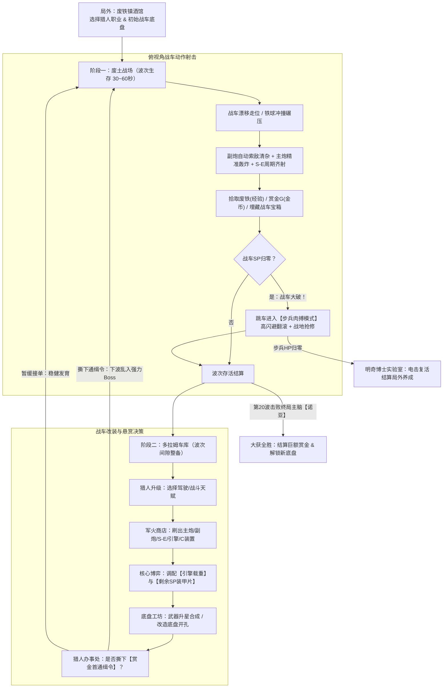

# 《重装废土：赏金狂飙》(Metal Wasteland: Bounty Overdrive) — 完整游戏策划案 (GDD v1.0)

> [!IMPORTANT]
> **核心一句话简介（High Concept）**
> **《重装机兵》的硬核战车改装与废土赏金首狩猎 × 《土豆兄弟 (Brotato)》的俯视角爽快割草与波次车库构筑。**
> 驾驶属于你的末世战车在机械兽潮中漂移轰炸，在「更重的神级火炮」与「更厚的装甲片（SP）」之间做生死博弈；随时撕下高额悬赏通缉令，迎战乱入战场的传奇赏金首！

---

## 一、 核心玩法循环 (Core Gameplay Loop)

采用 **20 波次生存 + 车库深度整备 + 主动悬赏挑战** 的结构，单局时长控制在 **20~25 分钟**。



---

## 二、 四大独创核心战斗机制

### 1. 战车物理驾驶与三层火力网
不同于传统幸存者游戏的“步行角色”，玩家操控的是一台具有**重量感、转向惯性与冲撞体积**的废土战车：
* **三层火力各司其职**：
  * **副炮（Sub-Gun）**：机枪/喷火器/酸液枪，**360° 独立炮塔自动索敌**，弹药无限，负责清理贴脸杂兵与施加异常状态（灼烧、酸蚀破甲、感电）。
  * **主炮（Main Cannon）**：大口径加农炮/激光炮，**高单伤、大范围爆炸或直线贯穿**。支持「自动锁定最高威胁目标」或「鼠标右键手动精确制导轰炸」。受**装填时间（Reload）**与**单波弹药量（Ammo）**限制（弹药在每波次开始时自动补满，或靠装填机恢复）。
  * **S-E（Special Equipment 特殊装备）**：多联装导弹/浮游无人机/迎击激光/旋转铁球，**按固定冷却周期或特定条件自动触发**（如：全屏追踪导弹洗地、自动拦截敌方远程子弹）。
* **战车碾压（Ramming）**：当战车总重量高于小型仿生怪时，高速移动撞击敌人会直接将其撞飞，并造成基于 `战车总吨位 × 移动速度` 的物理碾压伤害。

### 2. 《重装机兵》灵魂机制：载重（Weight）= 装甲片（SP）
本作将《重装机兵》最经典的载重机制转化为肉鸽构筑的核心资源博弈：
* 战车没有固定的最大生命值（HP），而是由**装甲片（SP, Shield Points）**承担所有伤害。
* **核心定律**：**引擎决定最大载重，所有未被武器和设备占用的剩余载重，自动全部转化为战车的 SP 装甲片！**
* **实时动态博弈**：
  * **玻璃大炮路线**：你在第 5 波刷出了一门传说级的 `220mm 盖亚巨炮（重达 18 吨）`，强行装上车后，你的剩余载重只剩 `1.5 吨`，战车瞬间变成只有 `150 SP` 的脆皮纸糊车——一炮毁天灭地，但被摸两下就解体！
  * **重装铁王八路线**：安装双引擎，只带轻型副炮与冲撞刺球，腾出 `45 吨` 剩余载重，转化为 `4500+ SP` 巨额护甲，直接往怪堆里横冲直撞。

### 3. 战损系统与「下车肉搏（Human Mode）」绝境反击
当战车的 SP 被打空时，玩家**不会立刻阵亡**，而是触发极具戏剧性的**人车分离机制**：
1. **战车大破（Wrecked）**：战车在原地引发一次小型殉爆震开周围敌人，随后化为冒黑烟的残骸（不可移动，武器停火）。
2. **猎人紧急跳车**：玩家控制小巧的猎人本体跳出战车，拥有独立的**人类生命值（HP）**与**翻滚无敌帧（空格键闪避）**，手持步兵武器（霰弹枪/激光剑/扳手）继续战斗。
3. **两种破局方式**：
   * **坚持到波次结束**：只要人类本体撑过本波剩余倒计时，进入车库后战车将免费自动修复。
   * **战地强修（Field Repair）**：围绕战车残骸边缘战斗，累计停留在残骸修理圈内满 `5 秒`（机械师职业仅需 `2 秒`），即可完成应急抢修，重新登车并恢复 `35% SP`！
4. **主动弃车玩法**：玩家甚至可以主动按 `E 键` 跳车，配合特定 C 装置让战车开启「自动驾驶巡航」，实现**人车同屏双打**！

### 4. 猎人办事处：主动撕取「赏金首通缉令（Wanted）」
在每波结束后的车库界面，除了买装备，右侧还会张贴当前区域的 **3 张悬赏通缉令**：
* 玩家可以根据自己当前的战车火力，**自由决定是否撕下通缉令**。
* 一旦撕下，**下一波次开启 6 秒后，该赏金首 Boss 将伴随警报声强行乱入战场！**
* **高风险高回报**：在规定波次内击杀赏金首，不仅能拿走巨额**赏金 G**，还必定掉落一件**专属传奇红装（Boss 唯一武器或核心部件）**！

### 5. 战场即时升级（边打边升）与「隐藏超武进化（Super Weapon Evolution）」
完美结合《吸血鬼幸存者》的局内即时正反馈与隐藏合成惊喜：
* **战场边打边捡经验即时升级**：
  * 战斗中击杀机械兽掉落「废铁零件（经验）」，经验条满的瞬间**无需等待波次结束**，战场直接进入战术时停并弹出**【战场即时三选一空投补给】**！
  * 玩家既可以选择强化猎人/战车属性，也可以直接选择**【战场空投武器】**（立刻装上战车、触发同名二合一升星，或凑齐超武配方！）。
* **隐藏机制：六大【神话超武（Mythic Evolution）】自动合成**：
  * 当战车上同时装备了配方指定的 **2 件关联武器**（且任意一件达到 `★2 精良` 以上，或在战场拾取了**【埋藏金属宝箱】**），两件武器将自动融合进化为 **1 件不占额外槽位、极低重量、威力毁天灭地的【★6 神话超武】**！

| 神话超武名称 | 隐藏合成配方 (武器 A + 武器 B) | 融合后超武质变效果 |
| :--- | :--- | :--- |
| **【血色红狼·双星歼灭炮】**<br>*(Crimson R-Wolf Twin Cannon)* | `105mm 皇家加农 / 205mm 红牡丹`<br>**+** `火神六管加特林` | 主炮与加特林合体！变为**无限弹药**的深红等离子速射主炮，**100% 必定暴击**，命中引发十字血色爆破。 |
| **【Ω 诺亚天谴轨道炮】**<br>*(Noah's Omega Railgun)* | `SE-宇宙激光主炮`<br>**+** `特斯拉连锁电弧` | 发射贯穿全屏的紫金雷霆主炮，并在全场最多 **10 个目标间弹跳高压天谴闪电**，瞬间麻痹机械Boss。 |
| **【末日铁幕·核子蜂群】**<br>*(Doomsday Missile Swarm)* | `ATM 追踪导弹箱`<br>**+** `龙卷风12联装火箭` | 化为全自动导弹母巢，每 2.2 秒向全屏倾泻 **20 枚高爆追踪核子飞弹**，导弹尾焰与火光覆盖全屏。 |
| **【明奇的炼狱黑死病】**<br>*(Plague Inferno Sprayer)* | `强酸腐蚀喷雾器`<br>**+** `地狱火焰喷射器` | 喷射黑死病炼狱酸火，每次命中直接削减目标 `18 点护甲` 并叠加满层灼烧，被击杀的敌人会发生**连环尸爆传染**！ |
| **【绝对领域·神盾粉碎星】**<br>*(Aegis Crusher Orbiters)* | `旋转刺球撞角`<br>**+** `宙斯盾迎击激光网` | **4 颗**缠绕电磁力场的超重合金流星锤环绕车身极速旋转，**100% 湮灭触碰的敌方弹幕**，碰撞伤害附加 `25% 战车最大SP` 并自动回血！ |
| **【盖亚毁灭者·石化核弹】**<br>*(Gaia Petrify Nuke)* | `水泥弹发射器`<br>**+** `195mm 爆裂巨炮 / 废铁霰弹炮` | 发射巨型石化子母核弹，大范围减速敌人 75% 且破除护甲，同时向四周分裂出 **10 颗高爆子母弹**二次洗地！ |

---

## 三、 首发角色与战车底盘设定

### 1. 六大首发猎人角色（决定被动天赋与步兵能力）

| 角色名称 | 初始定位 | 核心正面特性 | 负面限制 / 代价 |
| :--- | :--- | :--- | :--- |
| **王牌猎人**<br>*(Bounty Hunter)* | 主炮均衡流 | • 主炮伤害 `+20%`，装填速度 `+15%`<br>• 对「赏金首」精英与Boss伤害 `+25%`<br>• 每波战场必定额外刷出 1 个【埋藏金属箱】 | • 副炮与 S-E 槽位改装费用 `+25%` |
| **红狼传人**<br>*(Lone Wolf)* | 极致单炮暴击 | • 当战车**仅装备 1 门主炮**时，该主炮伤害 `+60%`、暴击率 `+25%`<br>• 暴击击杀敌人时立即返还 1 发主炮弹药 | • 无法安装任何无人机与同伴类配件<br>• 商店武器价格 `+15%` |
| **天才机械师**<br>*(Master Mechanic)* | 载重改装 & 续航 | • 引擎最大载重额外 `+25%`<br>• 波次中每秒自动恢复 `1.5% 最大SP`<br>• 商店刷新价格 `-40%`，底盘改孔免费 | • 主炮基础伤害 `-15%`<br>• 步兵肉搏攻击力 `-30%` |
| **废土武道家**<br>*(Iron Fist)* | 自爆卡车 & 肉搏 | • 人类肉搏 HP `+200%`，肉搏攻速与移速 `+40%`<br>• 可主动引爆战车造成 `10倍最大SP` 的全屏核爆伤害<br>• 步兵形态下每次暴击回复 5% HP | • 战车引擎载重上限 `-30%`<br>• 无法安装 C 装置的自动迎击模块 |
| **生化战犬·波奇**<br>*(Cyber Dog Pochi)* | 高速游击 & 吞噬 | • 以机械战犬形态直接出战（无人车分离）<br>• 基础移速 `+35%`，闪避率 `+20%`<br>• 击杀生化变异怪可拾取【基因肉块】，永久叠加最大生命与攻速 | • 无法安装重型主炮（所有槽位锁定为副炮与轻型 S-E） |
| **明奇学徒**<br>*(Dr. Mince's Aide)* | 元素异常 & 召唤 | • 电击、火焰、酸液伤害 `+35%`<br>• 被元素伤害击杀的机械兽有 `20%` 概率变成【带电僵尸机甲】为你作战 10 秒 | • 实弹类物理武器伤害 `-25%`<br>• 战车每吨载重转化的 SP 减少 `15%` |

---

### 2. 八大经典战车底盘（决定槽位结构与底盘技）

玩家在开局选择一台初始底盘，或在局内通过「金属探测器」挖出埋藏战车并在车库切换/双车编队：

| 底盘代号 | 原型致敬 | 初始孔位 (主/副/SE) | 基础自重 | 底盘装甲系数 (SP/吨) | 专属底盘特性 |
| :--- | :--- | :---: | :---: | :---: | :--- |
| **荒野巴吉**<br>*(Buggy)* | 1代初始吉普 | `1主 / 2副 / 1SE` | 3.0 t | 80 SP/t | **【沙地漂移】**：移动速度 `+20%`；处于移动状态时，所有副炮射速 `+35%`。 |
| **红狼战车**<br>*(R-Wolf)* | 红狼默克尔座驾 | `2主 / 1副 / 2SE` | 7.5 t | 100 SP/t | **【深红连星】**：主炮暴击时，有 `35%` 概率无视冷却与弹药立即追加发射一发。 |
| **复合重坦 M1**<br>*(Abrams)* | 经典主力战车 | `2主 / 2副 / 1SE` | 9.0 t | 130 SP/t | **【反应装甲】**：每吨剩余载重转化的 SP 提升 `30%`；受到碰撞与近战伤害 `-30%`。 |
| **暴风导弹车**<br>*(Missile Carrier)* | 导弹发射车 | `0主 / 1副 / 5SE` | 6.5 t | 90 SP/t | **【模块化发射架】**：无法安装主炮；所有 S-E 装备重量减轻 `35%`，S-E 冷却缩短 `20%`。 |
| **猛犸象要塞**<br>*(Mammoth)* | 超重型巨坦 | `3主 / 2副 / 2SE` | 15.0 t | 150 SP/t | **【双核驱动】**：天生拥有 **2 个引擎插槽**！移速 `-25%`，但碾压伤害 `+200%` 且免疫击退。 |
| **白色恶魔救护车**<br>*(Ambulance)* | 经典搞笑战车 | `0主 / 4副 / 2SE` | 4.5 t | 95 SP/t | **【过量医疗】**：战车每秒恢复值翻倍；溢出的 SP 修复量会以 `200%` 比例转化为全屏腐蚀毒雾伤害。 |
| **武装巴士**<br>*(Wasteland Bus)* | 载客大巴 | `1主 / 2副 / 1SE` | 8.0 t | 110 SP/t | **【车窗齐射】**：额外拥有 **4 个随从乘员槽**，雇佣的佣兵与战犬属性效果提升 `50%`。 |
| **暴龙生物战车**<br>*(Bio-Tyrannos)* | 生物合成战车 | `1主 / 1副 / 1SE`<br>*(随等级进化至 6 孔)* | 5.0 t | 120 SP/t | **【血肉装甲】**：每吃满 3 波经验自动进化并长出 1 个新武器孔；专属生物火炮不消耗弹药，改为消耗自身 `2% SP` 发射高爆酸液。 |

---

## 四、 战车武器与核心配件图鉴

### 1. 主炮系列（Main Cannons —— 爆发、破甲、大范围）
| 武器名称 | 品质 | 重量 (t) | 基础伤害 | 冷却 / 弹药 | 弹道与特效说明 |
| :--- | :---: | :---: | :---: | :---: | :--- |
| **45mm 速射机关炮** | 白~蓝 | 1.8 t | `35 (+80%主炮加成)` | 1.2s / 30发 | 三连发高速穿甲弹，轻便省重，适合前期过渡。 |
| **105mm 皇家加农** | 绿~紫 | 4.5 t | `110 (+120%主炮加成)` | 2.2s / 18发 | 命中后产生半径 2.5m 的高爆冲击波。 |
| **水泥弹发射器** | 蓝~紫 | 3.5 t | `65 (+90%主炮加成)` | 2.5s / 15发 | 命中后在地面铺设水泥泥潭，令敌人移速 `-60%`、护甲归零。 |
| **195mm 爆裂巨炮** | 蓝~红 | 8.0 t | `240 (+180%主炮加成)` | 3.2s / 12发 | 炮弹击杀目标时会分裂出 6 颗子母炸弹二次爆炸。 |
| **205mm 红牡丹** | 紫~红 | 10.5 t | `380 (+220%主炮加成)` | 3.8s / 10发 | 极高暴击倍率（`2.5x`），对半血以下敌人必定暴击。 |
| **SE-宇宙激光炮** | 紫~红 | 7.0 t | `190 (+150%能量加成)` | 2.8s / 无限 | 发射贯穿全屏的炽热激光束，无视实弹护甲，但每次发射使战车热量上升。 |
| **220mm 盖亚之怒** | 红 (传奇) | 16.0 t | `750 (+350%主炮加成)` | 5.0s / 6发 | 重装机兵终极主炮，一炮轰平半个屏幕并留下持续灼烧的陨石坑。 |

### 2. 副炮系列（Sub-Guns —— 自动索敌、清杂、叠异常）
| 武器名称 | 品质 | 重量 (t) | 单发伤害 | 射速 (发/秒) | 弹道与特效说明 |
| :--- | :---: | :---: | :---: | :---: | :--- |
| **7.7mm 机枪** | 白~蓝 | 0.5 t | `8` | 5.0 /s | 超轻重量，几乎不占 SP，精准点射最近目标。 |
| **火神加特林** | 绿~紫 | 2.2 t | `14` | 10.0 /s | 持续开火时射速逐渐翻倍，弹幕密集但有轻微散射。 |
| **地狱火焰喷射器** | 绿~紫 | 1.8 t | `10/跳` | 持续喷射 | 前方扇形火海，叠加【灼烧】层数（每秒造成最大生命百分比伤害）。 |
| **强酸喷雾器** | 蓝~紫 | 1.6 t | `12` | 3.5 /s | 发射腐蚀酸液球，每次命中永久削减目标 `5 点护甲`（可减至负数增伤）。 |
| **特斯拉电弧枪** | 蓝~红 | 2.0 t | `22` | 2.5 /s | 闪电在最多 5 个机械敌人之间弹跳，对机械单位伤害 `+50%`。 |
| **废铁霰弹炮** | 绿~红 | 2.5 t | `18 × 6颗` | 1.5 /s | 近距离扇形轰击并附带强力击退，每拾取 10 个废铁本波伤害 `+2%`。 |

### 3. S-E 特殊装备系列（Special Equipment —— 齐射弹幕、战术护盾）
| 装备名称 | 品质 | 重量 (t) | 基础效果 / 伤害 | 触发周期 | 战术定位与联动 |
| :--- | :---: | :---: | :---: | :---: | :--- |
| **ATM 追踪导弹** | 白~紫 | 2.0 t | `45 × 4枚` | 4.0s | 自动追踪全场血量最高的敌人。 |
| **龙卷风多管火箭** | 蓝~红 | 5.5 t | `35 × 16枚` | 6.5s | 漫天导弹无差别覆盖洗地，配合【全弹发射】瞬间清屏。 |
| **宙斯盾迎击激光** | 绿~红 | 1.5 t | 拦截敌方飞行物 | 0.8s | 自动击落半径 6m 内的敌方导弹与子弹；每次成功拦截回复 `5 SP`。 |
| **旋转刺球撞角** | 绿~紫 | 4.0 t | `60 + 200%战车总重` | 持续环绕 | 两颗重型尖刺铁球围绕车身高速旋转，碾碎近身杂兵并挡子弹。 |
| **浮游维修无人机** | 蓝~红 | 1.2 t | 每秒修复 `15 SP` | 持续生效 | 同时发射微型激光协助攻击，享受机械师技能加成。 |
| **音响震荡炮** | 蓝~紫 | 2.8 t | `80` (全屏音波) | 5.0s | 穿透一切障碍与护甲的声波攻击，震晕周围敌人 1.5 秒。 |

### 4. 引擎（Engines）与 C 装置（Computers）

* **引擎示例**：
  * **斗牛犬 V8（白~蓝）**：最大载重 `12~20 t`，移速 `+5%`。
  * **推土机重型柴油机（绿~紫）**：最大载重 `25~40 t`，移速 `-10%`，冲撞伤害 `+50%`。
  * **红狼特制涡轮（紫~红）**：最大载重 `28 t`，移速 `+25%`，每移动 10 米使下一发主炮伤害 `+15%`。
  * **诺亚核融引擎（红）**：最大载重 `55 t`，全武器伤害 `+35%`，但战车每秒因过热流失 `1% 当前SP`。
* **C 装置（流派核心大脑）示例**：
  * **【所罗门 2 型】**：解锁核心指令**「全弹发射」**——每 8 秒令车上所有主炮与 S-E 无视冷却同时齐射一轮！
  * **【99式神话】**：主炮命中率锁定 `100%`，暴击率 `+20%`，主炮单次伤害超过敌人生命上限时，溢出伤害转化为周围 AOE 冲击波。
  * **【幻影全息系统】**：战车闪避率 `+25%`；每次成功闪避在原地留下一个持续 3 秒的爆炸全息诱饵。
  * **【自律战斗AI·瓦尔基里】**：允许玩家开局直接处于「人车分离」状态，战车由高智能 AI 操控自动走位开火，且战车与猎人共享 100% 属性加成！

---

## 五、 六大肉鸽流派与词条羁绊 (Build Archetypes)

在商店购买武器和配件时，每件装备带有 **1~2 个流派标签（Tags）**，凑齐 `2 / 4 / 6` 件触发强力羁绊：

1. **【重炮轰鸣 (Heavy Artillery)】** *(主炮特化流)*
   * **羁绊效果**：(2) 主炮重量减轻 20%；(4) 主炮爆炸范围 +40%，附带破甲；(6) 主炮每次开火后，有 50% 概率触发【二连射】。
   * **成型体验**：搭配「红狼底盘」+「205mm红牡丹」+「99式神话C装置」，一炮轰出上万暴击数字，屏幕剧烈震动。
2. **【导弹暴雨 (Missile Storm)】** *(S-E 齐射流)*
   * **羁绊效果**：(2) S-E 发射数量 +1；(4) S-E 冷却缩短 25%；(6) 触发「全弹发射」时，额外召唤一轮轨道卫星激光轰炸。
   * **成型体验**：搭配「暴风导弹车」+「所罗门C装置」+ 5门多管火箭，满屏尾烟与爆炸火光，极致割草爽感。
3. **【钢铁碾压 (Heavy Juggernaut)】** *(超重护甲冲撞流)*
   * **羁绊效果**：(2) 每吨剩余载重额外提供 +30 SP；(4) 受到伤害时反射 `100% 战车总吨位` 的荆棘物理伤害；(6) 移动时不减速，撞击敌人产生范围震荡波（伤害等于当前 SP 的 15%）。
   * **成型体验**：搭配「猛犸象底盘」+ 双推土机引擎 + 旋转铁球，放弃远程开火，直接开着上万血的巨型坦克在怪堆里来回漂移碾压。
4. **【生化酸火 (Bio-Hazard)】** *(副炮元素持续流)*
   * **羁绊效果**：(2) 灼烧与酸蚀叠加上限翻倍；(4) 处于异常状态的敌人死亡时传染给周围 4 米内所有敌人；(6) 元素伤害可以暴击，且每层异常状态使目标受到的最终伤害 +3%。
5. **【人车双绝 (Lone Wolf & Cub)】** *(下车肉搏 & 随从召唤流)*
   * **羁绊效果**：(2) 人类 HP +100%，随从/战犬攻速 +30%；(4) 战车大破或主动弃车时，战车残骸变为持续放电的电磁塔；(6) 人类每次近战暴击，令场上战车立即发射一发免费主炮支援！
6. **【废铁大亨 (Scrap Tycoon)】** *(经济滚雪球流)*
   * **羁绊效果**：(2) 每波结束额外获得 +15% 赏金 G 利息；(4) 商店刷新有机会刷出「埋藏古董遗物」；(6) 每持有 100 G 赏金，全武器伤害 +8%。

---

## 六、 废土敌军生态：常规小怪、远程特种怪、四大精英与十大「赏金首 (Wanted)」

### 1. 六大职能小怪与重装精英图鉴（共 14 种）
为了避免割草过程单调，战场敌军按职能划分为 **近战虫群、自爆特攻、远程狙击/曲射、护盾/医疗干扰、重装精英** 五个战术层级，逼迫玩家进行目标优先级抉择：

| 职能分类 | 怪物名称 | 核心行为机制与反制策略 |
| :--- | :--- | :--- |
| **近战突袭** | **钳甲机械蚁**<br>*(Bio-Ant)* | 成群结队包围战车；体型小，可被高速移动的战车直接撞飞碾碎。 |
| **近战突袭** | **狂暴生化猎犬**<br>*(Bionic Hound)* | 高移速机械狼，接近战车 160m 时会发起**红眼加速扑咬冲刺**，专克低移速重坦。 |
| **自爆特攻** | **自爆滚雷车**<br>*(Kamikaze Wheel)* | 极高移速贴脸引爆，需靠副炮机枪或旋转刺球提前引爆。 |
| **自爆特攻** | **毒气自爆铁桶**<br>*(Toxic Walker)* | 死亡或自爆时在地面留下一片持续 4 秒的**【强酸毒雾池】**，战车驶入将持续损失 SP。 |
| **远程火力** | **沙漠机枪炮台**<br>*(Sand Turret)* | 中距离游走，周期性发射实弹点射弹幕。 |
| **远程火力** | **辐射酸液蜗牛**<br>*(Acid Snail)* | 高护甲远程怪，发射腐蚀酸液弹。 |
| **远程狙击** | **远程狙击自行炮**<br>*(Sniper Cannon)* | 游走于屏幕边缘，开火前拉出 **1.0 秒红色激光瞄准线**，随后发射超高速高伤穿甲狙击弹！ |
| **曲射轰炸** | **迫击炮机械蟹**<br>*(Mortar Crab)* | 发射高抛物线迫击炮，在玩家脚下生成**【红色轰炸预警圈】**（1.2秒后落弹爆炸，无视防空拦截网，必须走位躲避）。 |
| **护盾防御** | **电磁护盾卫士**<br>*(Shield Mecha)* | 携带蓝色**【能量护盾】**（大幅吸收实弹伤害，但受到**电击/激光**攻击时护盾受 300% 破盾伤害）。 |
| **医疗支援** | **诺亚战地维修蜂**<br>*(Repair Drone)* | **高优先级击杀目标！** 围绕精英怪或赏金首飞行，每 1.5 秒发射绿色维修光束为周围敌军回血。 |
| **战术控制** | **磁暴捕猎蛛**<br>*(EMP Spider)* | 发射蓝色**【EMP 电磁网弹】**，命中战车会使战车移速降低 `45%` 持续 2 秒。 |
| **⚡重装精英** | **【精英】自律杀戮重坦**<br>*(Elite Auto-Tank)* | 金色精英光环，扇形三连发主炮轰击；**击杀高概率掉落【埋藏金属宝箱】与维修包**。 |
| **⚡重装精英** | **【精英】炼狱喷火装甲车**<br>*(Elite Flame Juggernaut)* | 高速追击并持续喷射扇形高温火墙，死后引发大范围燃料殉爆。 |
| **⚡重装精英** | **【精英】双联装导弹巨兽**<br>*(Elite Missile Mammoth)* | 周期性呼叫 **3 连发高空迫击导弹轰炸圈** + 环形自卫弹幕。 |
| **⚡重装精英** | **【精英】诺亚量子处决者**<br>*(Elite Cyber Executioner)* | 高阶赛博精英，每隔 3.2 秒**瞬移闪烁（Blink）**至玩家身旁并释放十字雷霆斩！ |

---

### 2. 十大「赏金首 (Wanted)」Boss 设计

| 悬赏阶位 | 赏金首名称 | 推荐波次 | 悬赏金 (G) | 核心战斗机制与部位破坏 | 专属红装掉落 |
| :---: | :--- | :---: | :---: | :--- | :--- |
| **★☆☆☆☆** | **杀人推土机**<br>*(Killdozer)* | 波次 3~6 | 300 G | 正面装有巨型合金铲刀（**免疫正面实弹伤害**），会锁定玩家发起红线预警冲锋；需漂移绕到其侧面或背后攻击引擎散热口。 | **【合金推土铲】**<br>*(撞击伤害+150%，正面减伤30%)* |
| **★☆☆☆☆** | **加农水母**<br>*(Cannon Jelly)* | 波次 4~7 | 350 G | 悬浮仿生机械，周期性发射环形弹幕并分裂自爆小水母；使用**电击属性**攻击可使其短路瘫痪 3 秒。 | **【水母脉冲发生器】**<br>*(S-E：周期释放麻痹电环)* |
| **★★☆☆☆** | **沙漠之鲛·沙鲨**<br>*(Sand Shark)* | 波次 7~10 | 650 G | 潜入沙地高速游动（地面浮现沙尘轨迹，此时仅受声波/爆炸伤害），跃出沙面时发射扇形鱼雷齐射。打断其背鳍鱼雷架可废除其大招。 | **【沙鲨钻地鱼雷】**<br>*(主炮：无视障碍钻地追踪)* |
| **★★☆☆☆** | **臭鼬战队·斯卡鲁**<br>*(Skunks)* | 波次 8~12 | 800 G | 驾驶三辆高速喷火摩托围绕玩家画圈，在地面留下燃烧火墙封锁走位；击杀两辆护卫车后首领会进入狂暴连射状态。 | **【臭鼬氮气推进器】**<br>*(引擎挂件：漂移留下火焰路径)* |
| **★★★☆☆** | **百足装甲列车**<br>*(Centipede Express)* | 波次 10~14 | 1,100 G | 由 **8节独立车厢** 组成的巨型机械蜈蚣（分别搭载机枪、导弹、维修站）。**每打爆一节车厢直接掉落一个装备箱**，但剩余车身移速会越来越快！ | **【列车联结磁轨炮】**<br>*(主炮：每多装1件武器伤害+25%)* |
| **★★★☆☆** | **掠夺王·戈麦斯**<br>*(Gomez)* | 波次 12~16 | 1,400 G | 红狼的宿敌，驾驶重装迷彩坦克。会投掷烟雾弹隐身，并发射**【捕猎电磁网】**禁锢玩家战车 2 秒，紧接着蓄力发射毁灭主炮（可跳车躲避或用迎击激光打断）。 | **【戈麦斯的卑劣黑匣】**<br>*(C装置：偷取Boss属性并致盲)* |
| **★★★★☆** | **生化奇美拉**<br>*(Bio-Chimera)* | 波次 14~18 | 1,800 G | 巨型章鱼与重坦的恶心融合体。拥有极高生命再生速度，4条机械触手独立拍击地面；必须用**火焰或酸液**抑制其回血才能将其击杀。 | **【奇美拉再生细胞】**<br>*(底盘核心：每秒回复3%最大SP)* |
| **★★★★☆** | **陆地战舰·沙漠之舟**<br>*(Desert Boat)* | 波次 15~19 | 2,500 G | 占据半个屏幕的移动巨型要塞！拥有 **【左副炮群】【右导弹舱】【中央300mm主炮】3个独立可破坏部位**。全部拆毁后核心裸露。 | **【沙漠之舟主炮·大和】**<br>*(超重型三联装主炮)* |
| **★★★★★** | **钢铁暴君·重装帕鲁**<br>*(Bighemoth)* | 波次 19 / 乱入 | 4,000 G | 吞噬无数战车残骸长成的钢铁巨兽，自带磁力场吸引玩家战车并发射全屏散射激光。 | **【帕鲁吞噬核心】**<br>*(拾取废铁直接永久增加最大载重)* |
| **★★★★★** | **灭世主脑·诺亚**<br>*(Master NOAH)* | 第 20 波终局 | 通关大奖 | **三阶段终局Boss**：<br>• P1：防卫矩阵（四座能量塔护盾）<br>• P2：机械造物主（召唤历代赏金首残影协同攻击）<br>• P3：过载核心（全屏弹幕与十字切割激光死斗） | **【诺亚量子C装置】**<br>*(解锁新难度与隐藏底盘)* |

---

## 七、 核心数值公式体系 (Mathematical Model)

为了保证后续写代码时手感和策略深度兼具，核心数值公式设定如下：

### 1. 载重与装甲片（SP）计算公式
设引擎提供的基础载重为 $W_{\text{engine}}$，机械师/天赋加成为 $R_{\text{bonus}}$，当前车上所有武器与配件重量之和为 $W_{\text{equip}} = \sum w_i$，底盘装甲转化系数为 $K_{\text{chassis}}$（默认约为 $100\text{ SP/吨}$）：

$$\text{最大载重 } W_{\max} = W_{\text{engine}} \times (1 + R_{\text{bonus}})$$

$$\text{剩余载重 } W_{\text{free}} = \max(0, W_{\max} - W_{\text{equip}})$$

$$\text{战车最大装甲片 } \text{SP}_{\max} = \text{Base\_SP} + W_{\text{free}} \times K_{\text{chassis}} \times (1 + \text{SP\%加成})$$

> [!TIP]
> **超载惩罚与极限改装**：如果玩家强行装上超过 $W_{\max}$ 的武器，每超载 $1\text{ 吨}$，战车移动速度降低 $15\%$；超载超过 $30\%$ 时无法出击，必须卸下武器、升级引擎或丢弃装甲。

### 2. 伤害与护甲减伤公式
本作区分 **实弹伤害（Ballistic）**、**能量/激光伤害（Energy）** 与 **元素伤害（Elemental）**：
* **单次武器基础面板**：
  $$\text{Dmg}_{\text{raw}} = \left(\text{Weapon\_Base} + \text{Stat\_Flat} \times \text{Scaling}\right) \times (1 + \text{Damage\%}) \times \text{Crit\_Multiplier}$$
* **敌方护甲减伤（采用类 Dota/Brotato 收益递减公式，支持负护甲增伤）**：
  $$\text{护甲减伤率 } M_{\text{armor}} = \frac{\text{Armor}}{|\text{Armor}| + 50}$$
  $$\text{最终伤害 } \text{Dmg}_{\text{final}} = \text{Dmg}_{\text{raw}} \times (1 - M_{\text{armor}})$$
  * 当敌方护甲为 `50` 时，减伤 `50%`（主炮自带「穿甲率」可无视对应比例的护甲）。
  * 当副炮「强酸喷雾器」将敌方护甲腐蚀到 `-25` 时，$M_{\text{armor}} = -25 / 75 = -33.3\%$，即**全队对其造成 `133.3%` 的额外增伤**！这就形成了**「副炮破甲 + 主炮一发入魂」**的经典配合。

### 3. 波次经济与商店刷新曲线
* **第 $N$ 波敌军总生命预算**：$\text{HP\_Scale}(N) = 1.0 + 0.25 \times (N - 1) + 0.04 \times (N - 1)^2$
* **第 $N$ 波商店物品基础价格**：$\text{Price}(N) = \text{Base\_Cost} \times (1 + 0.12 \times (N - 1))$
* **武器合成升星规则**：两把同名同品质武器可在车库免费合成为高一阶品质（`白[1星] → 绿[2星] → 蓝[3星] → 紫[4星] → 红[5星传奇]`），合成后**重量仅增加 `10%`，但基础伤害提升 `65%`**——鼓励玩家通过合成来节省宝贵的引擎载重！

---

## 八、 特色小玩法与彩蛋节点（波次间奇遇）

在车库整备界面，除了常规商店，每 3 波会随机触发一个《重装机兵》经典废土设施：
1. **【金属探测器挖掘】**：花费少量赏金在雷达网格上探测，挖出「生锈的主炮」（洗练后有概率变成越级红武）或「埋藏战车底盘」。
2. **【自动售货机抽奖】**：投入 10 G 买废土冷饮（小幅加人类属性），有 `15%` 概率触发经典的**「中奖啦！再来一瓶！」**，连续中奖 3 次直接奖励一件随机紫色核心配件。
3. **【战车打蜡/涂装店】**：给战车打蜡，使下一波次前 20 秒内**闪避率 +30% 且免疫酸液腐蚀**（非常适合在挑战赏金首前购买）。
4. **【红狼的乱入救援】**：当你在挑战高阶赏金首且战车 SP 低于 20% 时，有小概率伴随专属吉他 BGM，传奇猎人**「红狼（Red Wolf）」**驾驶红色战车从屏幕外冲入战场，替你轰出一发毁天灭地的主炮并留下一箱弹药补给后潇洒离去！

---

## 九、 局外永久养成与轮回解锁系统 (Meta-Progression)

每次轮回结束（无论是被明奇博士电击拖回实验室，还是第 20 波击败诺亚通关），玩家本局的战绩都会结算为局外永久货币——**【诺亚晶片 (Noah Chips `💎`)】**，并自动持久化保存至本地存档。

### 1. 轮回结算公式（诺亚晶片 `💎` 获取途径）
$$\text{本局获得晶片 } \Delta C = (\text{抵达波次} \times 15) + (\text{击杀机械兽} \times 1) + (\text{狩猎赏金首} \times 80) + \lfloor \text{剩余赏金G} / 10 \rfloor + \text{通关奖励}(500)$$

### 2. 四大局外解锁维度

| 解锁维度 | 内容明细 | 消耗货币 (`💎`) | 局内实际改变 |
| :--- | :--- | :---: | :--- |
| **① 解锁新人物**<br>*(猎人招募所)* | • 初始可用：王牌猎人、天才机械师<br>• 可解锁：**红狼传人**、**废土武道家**、**生化战犬·波奇**、**明奇学徒** | `120 ~ 280 💎` | 解锁全新战斗机制（如武道家自爆卡车核弹、波奇基因吞噬、明奇电击僵尸）。 |
| **② 解锁新底盘**<br>*(埋藏战车库)* | • 初始可用：荒野巴吉、复合重坦 M1<br>• 可解锁：**红狼战车**、**暴风导弹车**、**白色恶魔救护车**、**武装大巴**、**猛犸象要塞(双引擎)**、**暴龙生物战车** | `150 ~ 400 💎` | 解锁截然不同的武器开孔布局与底盘专属被动。 |
| **③ 解锁新功能**<br>*(废铁镇基建)* | • **【军火库锁定器】**：商店新增 `[🔒锁定]` 按钮，跨波次保留心仪红武<br>• **【多拉姆5号展柜】**：每波军火商店刷新格子从 4 格扩充至 **5 格**<br>• **【售货机特权】**：解锁车库自动售货机抽奖，提高“再来一瓶”概率<br>• **【高敏金属探头】**：解锁车库沙漠挖掘功能，战场埋藏宝箱刷新率翻倍<br>• **【黑市悬赏网】**：解锁猎人办事处 `[刷新通缉令]` 功能，赏金首奖励 `+25%`<br>• **【明奇高压除颤仪】**：Lv.1 解锁局中车库复活；Lv.2 解锁战场原地满血电击复苏 | `80 ~ 360 💎` | 逐步开放核心系统机制，让每一次轮回都有新的操作工具与策略维度。 |
| **④ 永久数值科技**<br>*(明奇改造所)* | 1. **超导引擎曲轴** (Lv.10)：引擎最大载重永久 `+5% / 级` (直接转化海量SP)<br>2. **复合钛合金板** (Lv.10)：战车基础装甲片永久 `+60 SP / 级`<br>3. **大口径膛线研磨** (Lv.10)：全武器基础伤害永久 `+6% / 级`<br>4. **猎人协会抚恤金** (Lv.8)：开局初始携带赏金永久 `+35 G / 级`<br>5. **液压自动装填机** (Lv.8)：装填与射速永久 `+4% / 级`，主炮弹仓 `+15% / 级`<br>6. **诺亚量子火控** (Lv.6)：初始暴击率 `+2.5% / 级`，闪避率 `+2% / 级`<br>7. **机械师纳米扳手** (Lv.6)：每秒自动修车 `+12 SP / 级`，下车抢修速度 `+12% / 级`<br>8. **废土赏金声望** (Lv.5)：拾取磁吸范围 `+20% / 级`，赏金与经验获取 `+8% / 级` | 随等级递增<br>`40 ~ 450 💎` | 构筑成长正反馈，帮助玩家挑战更高悬赏星级的赏金首。 |

---

## 十、 五大废土战区地图与三档难度体系 (Maps & Difficulties)

游戏采用**章节战区递进解锁制**，共设 **5 张《重装机兵》经典风格地图**（每张地图 10 波紧凑战役）。**必须击败当前地图的关底统帅赏金首，才能解锁下一张地图！**

### 1. 五大战区地图与专属赏金首分配

| 战区章节 | 地图名称与环境视觉 | 敌军属性倍率 | 专属小怪生态 | 驻守悬赏首领 (车库可接单) | 关底镇守统帅 (第10波死斗) |
| :---: | :--- | :---: | :--- | :--- | :--- |
| **第 1 章**<br>*(初始开放)* | **拉多镇荒野·巨炮峡谷**<br>*(黄沙弹坑荒漠)* | 生命 `1.0x`<br>伤害 `1.0x`<br>晶片 `1.0x` | 钳甲机械蚁<br>自爆滚雷车<br>沙漠机枪塔 | ★ **杀人推土机**<br>*(正面铲刀免疫+冲锋)* | ★ **加农水母**<br>*(360°环形弹幕+弱电)* |
| **第 2 章**<br>*(通第1章解锁)* | **死亡大沙漠·流沙遗迹**<br>*(炽热红沙海)* | 生命 `1.65x`<br>伤害 `1.35x`<br>晶片 `1.4x` | 自爆滚雷车<br>沙漠机枪塔<br>辐射酸液蜗牛 | ★★ **沙漠之鲛·沙鲨**<br>*(潜沙突袭+鱼雷齐射)* | ★★ **臭鼬军团长·斯卡鲁**<br>*(高速绕圈铺设火海)* |
| **第 3 章**<br>*(通第2章解锁)* | **铁道废墟·百足峡谷**<br>*(暗铁工业废墟)* | 生命 `2.50x`<br>伤害 `1.75x`<br>晶片 `1.85x` | 沙漠机枪塔<br>辐射酸液蜗牛<br>自律杀戮战车 | ★★★ **百足装甲列车**<br>*(多节车厢断节爆宝箱)* | ★★★ **掠夺王·戈麦斯**<br>*(隐身烟雾+电磁网重炮)* |
| **第 4 章**<br>*(通第3章解锁)* | **恶魔跨海大桥·枯竭海床**<br>*(深绿生化海床)* | 生命 `3.80x`<br>伤害 `2.25x`<br>晶片 `2.4x` | 变异机械蚁群<br>辐射酸液蜗牛<br>自律杀戮战车 | ★★★★ **生化融合兽·奇美拉**<br>*(超速再生+酸液弹幕)* | ★★★★ **陆地战舰·沙漠之舟**<br>*(三部位独立破坏巨舰)* |
| **第 5 章**<br>*(通第4章解锁)* | **地球救济中心·诺亚地心**<br>*(赛博紫金矩阵)* | 生命 `5.50x`<br>伤害 `3.00x`<br>晶片 `3.5x` | 全种类高阶<br>精英机械潮 | ★★★★★ **钢铁暴君·重装帕鲁**<br>*(引力黑洞+散射激光)* | ★★★★★ **灭世主脑·诺亚核心**<br>*(三阶段终局死斗)* |

### 2. 单图三档难度选择（简单 / 困难 / 地狱）

每张已解锁的地图均支持独立选择 3 种难度，并记录每张地图的通关奖章：

| 难度档位 | 敌军数值修正 | 特殊机制与提示规则 | 奖励加成 |
| :--- | :--- | :--- | :--- |
| **🟢 简单 (Easy)**<br>*废土巡逻* | • 敌军生命 `× 0.75`<br>• 敌军伤害 `× 0.75` | • **开启全套流派羁绊与超武配件合成提示**<br>• 刷怪频率降低 `15%`，开局额外获赠 `+50 G` | • 诺亚晶片结算 `× 1.0`<br>• 通关即可解锁下一张地图 |
| **🟡 困难 (Hard)**<br>*赏金猎人* | • 敌军生命 `× 1.00`<br>• 敌军伤害 `× 1.00` | • **开启全套流派羁绊与超武配件合成提示**<br>• 标准废土兽潮密度与Boss技能周期 | • 诺亚晶片结算 `× 1.35`<br>• 赏金首悬赏金 `× 1.25` |
| **🔴 地狱 (Hell)**<br>*大破坏梦魇* | • 敌军生命 `× 1.75`<br>• 敌军伤害 `× 1.50` | • **【硬核盲配】隐藏所有流派羁绊与超武合成配方提示！**<br>• 敌军移速 `+12%`，刷怪密度 `+30%` | • 诺亚晶片结算 **`× 2.20`**<br>• 赏金首悬赏金 **`× 1.80`** |

---

## 十一、 高精度 2D 废土机甲与赏金首美术图集 (2D Art Atlas)

全部 **49 张独立透明通道 PNG 精灵与地形贴图** 已切图去背并导入 Godot 4 工程目录 `res://assets/sprites/`，实现战场俯视渲染与车库/大本营/通缉令 UI 立绘的全面绑定：

````carousel

<!-- slide -->

<!-- slide -->

<!-- slide -->

<!-- slide -->

<!-- slide -->

````


